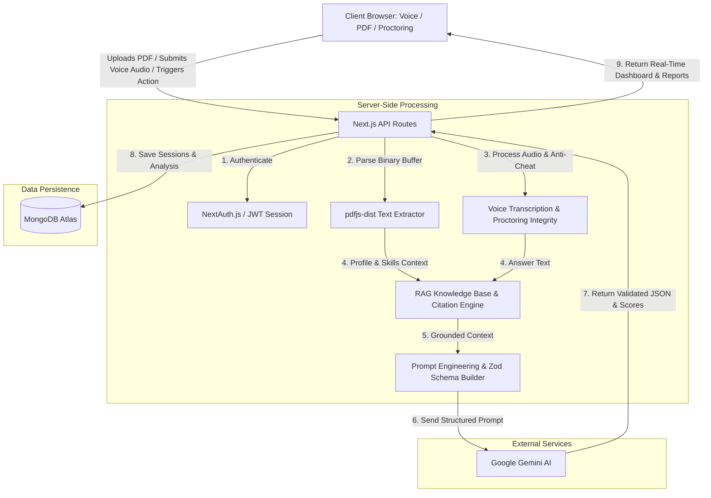

<div align="center">
  
# 🚀 CareerPilot AI
**Your Intelligent Career Mentor & Placement Readiness Platform**

[](https://nextjs.org/)
[](https://react.dev/)
[](https://www.mongodb.com/)
[](https://ai.google.dev/)
[](https://tailwindcss.com/)
[](https://next-auth.js.org/)
[](https://www.typescriptlang.org/)

**Live Demo:** [https://career-pilot-ai-1wmq.vercel.app/](https://career-pilot-ai-1wmq.vercel.app/)

</div>

---

## 🌟 Overview

**CareerPilot AI** is a comprehensive, production-grade career intelligence and interview preparation ecosystem engineered specifically for college students and ambitious professionals. Navigating the journey from academia to high-impact technical roles requires objective feedback, targeted skill roadmaps, and authentic interview practice.

CareerPilot AI bridges this gap through a multi-tiered AI architecture powered by **Google Gemini** and a **curated RAG (Retrieval-Augmented Generation) knowledge engine**. From instant ATS resume parsing to live, voice-enabled mock interviews with fullscreen anti-cheat proctoring, CareerPilot turns unstructured career data into quantifiable readiness and verifiable growth.

---

## ✨ Core Features & Latest Capabilities

*   🎙️ **Interactive AI Mock Interview Simulation (Latest Upgrade):**
    *   **Real-time Voice-to-Text Recording:** Speak responses naturally using browser Web Audio / MediaRecorder with live waveform visualization and AI-driven filler-word removal (*"um"*, *"uh"*, *"like"*, *"you know"*).
    *   **Anti-Cheat Fullscreen Proctoring:** Rigorous examination mode featuring fullscreen enforcement, tab-switch monitoring, strike tracking, and integrity violation safeguards.
    *   **4-Dimensional Rubric Evaluation:** Answers are graded with granular breakdowns across **Correctness (40%)**, **Logical Reasoning (25%)**, **Clarity & Communication (20%)**, and **Concept Coverage (15%)**.
    *   **Comprehensive Scorecards:** Instant access to strengths, critical improvement areas, and model benchmark answers.
    *   **Flexible Timer Controls & Session Management:** Per-question countdowns, session timers, and persistent report history with single-click deletion confirmation.

*   📚 **RAG Knowledge Base & Grounded Citations (Phase 2):**
    *   Grounded in verified role competency frameworks, skill prerequisite chains, and verified learning resources.
    *   Validates AI recommendations against authoritative industry models with verifiable citations, eliminating hallucinations.

*   📄 **AI Resume Parsing & Extraction:**
    *   Upload PDF resumes and extract education, skills, work experience, and projects in milliseconds using Mozilla's binary buffer parser (`pdfjs-dist`).

*   📊 **Comprehensive Placement Readiness Score:**
    *   Holistic 0–100 scoring algorithm evaluating technical skills, project depth, experience quality, and role alignment.

*   🤖 **ATS Optimization & Bullet-Point Enhancement:**
    *   Applicant Tracking System parsing simulation providing overall keyword match scores, structural audit, and quantified bullet-point rewriting suggestions.

*   🎯 **Skill-Gap Analysis & Industry Benchmarking:**
    *   Identifies missing skills for your target role, categorized by priority (**High**, **Medium**, **Low**) with direct prerequisite mapping.

*   🗺️ **Personalized Dynamic Learning Roadmaps:**
    *   Generates week-by-week, phased action plans complete with milestone goals, curated resources, and checkpoint evaluations.

*   🛠️ **Curated Portfolio Project Blueprints:**
    *   Tailored, production-ready project suggestions with technical architectures, prerequisite stacks, and difficulty ratings to construct compelling proof-of-work portfolios.

*   🎤 **Targeted Interview Practice (Read-Only Q&A):**
    *   A curated repository of technical and behavioral interview questions generated directly from your resume and target role with structured STAR-method guidance.

---

## 🏗️ Architecture & Technology Stack

CareerPilot AI is architected on a modern, serverless-first stack built for sub-second responsiveness, strict validation, and developer agility.

### **Frontend Layer**
*   **Next.js 16 (App Router):** Server Components (RSC) and dynamic client routing for high performance.
*   **React 19:** Modern concurrent features and reactive state primitives.
*   **Tailwind CSS v4 & tw-animate-css:** Modern styling with dark mode tokens and HSL palettes.
*   **Shadcn/ui & Radix Primitives:** Fully accessible, unstyled interactive components (Dialogs, Tabs, Accordions, Sheets, Badges).
*   **Framer Motion:** Fluid animations, layout transitions, and interactive visualizers.
*   **Lucide Icons:** Clean, modern iconography across all dashboards.
*   **Sonner:** Toast notification system.

### **Backend Layer (Next.js API Routes)**
*   **Serverless Route Handlers:** Dynamic API endpoints with session authentication and payload validation.
*   **PDF-JS Dist:** Binary stream extraction for accurate, client-independent PDF text parsing.
*   **Voice Audio Processing:** Native Web Audio API and Web Speech synthesis with Gemini transcription and filler-word suppression.
*   **Anti-Cheat Event Listener:** Tab-visibility state detection, fullscreen change listeners, and strike recording.

### **Data, AI & RAG Layer**
*   **Google Gemini API (`gemini-flash-lite-latest`):** High-speed generative AI with structured JSON schema enforcement via Zod.
*   **RAG Knowledge Retrieval (`lib/knowledge/`):** Context-aware retrieval engine filtering competency frameworks, skill dependencies, and learning citations.
*   **Strict Scoring Rubric (`lib/scoring.ts`):** Deterministic weights (`INTERVIEW_WEIGHTS`), adaptive difficulty calculations, and grade brackets.
*   **MongoDB Atlas (Mongoose 9):** Schema-validated persistence with models for `User`, `Resume`, `CareerScore`, `SkillGap`, `Roadmap`, `ATSReview`, `InterviewPrep`, `MockInterview`, `ProjectRecommendation`, and `KnowledgeItem`.
*   **NextAuth.js (Auth.js v5):** Secure authentication supporting Google OAuth and Email/Password credentials with Bcrypt hashing.

---

## 📐 System Architecture Flow



---

## 📂 Project Directory Structure

```text
├── app/
│   ├── (app)/layout.tsx           # Authenticated application shell & sidebar
│   ├── api/                       # Next.js Serverless API routes
│   │   ├── analyze-resume/        # Resume text extraction & parsing
│   │   ├── ats-review/            # ATS compatibility & keyword evaluation
│   │   ├── career-score/          # Readiness scoring endpoint
│   │   ├── interview-preparation/ # Practice questions generation
│   │   ├── mock-interview/        # Start, submit, and transcribe voice sessions
│   │   ├── project-recommendation/# Portfolio project recommendations
│   │   ├── roadmap/               # Multi-week career roadmap builder
│   │   └── skill-gap/             # Market-aligned skill gap analysis
│   ├── ats-review/                # ATS scan dashboard & bullet rewriter
│   ├── career-analysis/           # Career score breakdown & insights
│   ├── dashboard/                 # Central user overview & metrics
│   ├── interview/                 # Read-only interview practice questions
│   ├── mock-interview/            # Interactive voice & proctored mock interview
│   ├── projects/                  # Curated portfolio projects
│   ├── resume/                    # Resume upload and structured viewer
│   ├── roadmap/                   # Phased dynamic learning roadmap
│   ├── skill-gap/                 # Skill gap breakdown & learning priorities
│   ├── page.tsx                   # High-conversion landing page
│   └── globals.css                # Tailwind CSS v4 design tokens & themes
├── components/
│   ├── layout/                    # Sidebar, MobileNav, headers
│   ├── mock-interview/            # VoiceRecorder & audio visualizer
│   └── ui/                        # Reusable Shadcn UI primitives
├── lib/
│   ├── knowledge/                 # RAG knowledge base, retrieval & citations
│   ├── prompts/                   # Highly engineered Gemini prompt templates
│   ├── auth.ts                    # NextAuth.js v5 configuration
│   ├── db.ts                      # MongoDB connection caching
│   ├── scoring.ts                 # 4-pillar interview scoring algorithms
│   └── validation.ts              # Zod validation schemas for AI outputs
├── models/                        # Mongoose data schemas
└── test/                          # Node.js automated test suites
```

---

## 🧪 Testing & Validation

CareerPilot AI includes comprehensive automated test suites covering scoring algorithms, RAG retrieval, output schema validation, and session lifecycles:

*   **`test/phase02.test.ts`**: Verifies knowledge base integrity, RAG metadata filtering, citation correctness, rubric scoring weights, and adaptive difficulty.
*   **`test/scoring.test.ts`**: Asserts deterministic scoring calculations across correctness, reasoning, clarity, and coverage dimensions.
*   **`test/validation.test.ts`**: Ensures Gemini AI responses strictly adhere to defined Zod schemas.
*   **`test/lifecycle.test.ts`**: Validates end-to-end interview session state transitions and integrity logging.

Run tests locally:
```bash
npx tsx --test test/*.test.ts
```

---

## 🚀 Getting Started (Local Development)

### 1. Prerequisites
*   **Node.js** (v18.0.0 or higher)
*   **MongoDB Atlas** URI or local MongoDB instance
*   **Google Gemini API Key** (Obtain from [Google AI Studio](https://aistudio.google.com/))
*   **Google OAuth Credentials** (Optional, for Google Sign-In)

### 2. Clone the Repository
```bash
git clone https://github.com/abhinavpramanik/CareerPilot-AI.git
cd CareerPilot-AI
```

### 3. Install Dependencies
```bash
npm install
```

### 4. Environment Variables
Create a `.env.local` file in the project root:

```env
# MongoDB Database
MONGODB_URI="mongodb+srv://<user>:<password>@cluster.mongodb.net/careerpilot"

# NextAuth Configuration
NEXTAUTH_URL="http://localhost:3000"
NEXTAUTH_SECRET="your-secure-random-32-char-string"

# Google Gemini AI Key
GEMINI_API_KEY="your-gemini-api-key"

# Google OAuth (Optional)
GOOGLE_CLIENT_ID="your-google-client-id"
GOOGLE_CLIENT_SECRET="your-google-client-secret"
```

### 5. Run the Development Server
```bash
npm run dev
```

Open [http://localhost:3000](http://localhost:3000) in your browser.

---

## 🎨 Design Philosophy
CareerPilot AI delivers an editorial, developer-first aesthetic inspired by tools like Vercel and Linear. Built natively with dual dark/light themes, subtle glassmorphism (`backdrop-blur`), accessible contrast ratios, and micro-animations, the interface provides a responsive, intuitive, and elevated experience for career acceleration.

---

<div align="center">
  <i>Empowering students and engineers to navigate their careers with clarity and confidence.</i>
</div>
